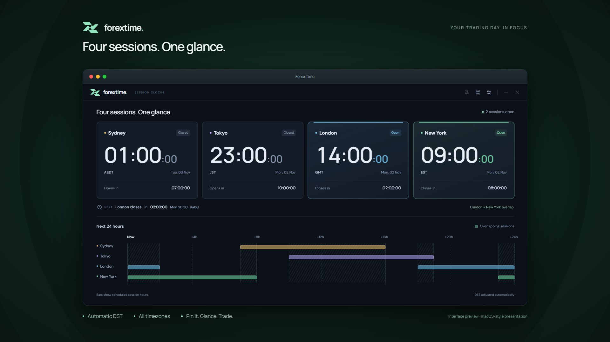

<p align="center">
  
</p>
<h1 align="center">Forex Time</h1>
<p align="center"><strong>Four sessions. One glance.</strong></p>
<p align="center">Sydney · Tokyo · London · New York</p>
<p align="center">
  <a href="https://github.com/SohailRaoufi/Forex-Time/releases/latest">Download for Windows & macOS</a>
  · <a href="#use">Features</a>
  · <a href="#run">Build from source</a>
  · <a href="LICENSE">MIT License</a>
</p>



<p align="center"><sub>1920 × 1080 interface preview, presented in a macOS-style frame.</sub></p>

A borderless Forex clock for Sydney, Tokyo, London and New York. React 19,
TypeScript, Tailwind CSS 4
and Radix UI on Tauri v2, with a Rust-owned clock engine.

## Download

[Download the latest desktop release](https://github.com/SohailRaoufi/Forex-Time/releases/latest).
Choose the Windows x64 setup, Apple Silicon DMG, or Intel Mac DMG.
The release includes SHA-256 checksums for every installer.

Windows installers are currently unsigned. Mac builds are ad hoc signed and not
Apple-notarized, so operating-system trust prompts may appear.

## Run

Requires Node.js 22.12+ (or 24), Rust MSVC, Visual Studio C++ Build Tools with a
Windows SDK, and Microsoft Edge WebView2 on Windows.

```powershell
npm ci
npm run desktop
```

Build a standalone executable without an installer:

```powershell
npm run desktop:build
```

The Windows executable is `src-tauri/target/release/forex-time.exe`.
Build a Windows installer with `npm run desktop:setup`; the output is in
`src-tauri/target/release/bundle/nsis/`. On a Mac with Xcode Command Line Tools,
Node.js and Rust installed, use `npm run desktop:dmg`; the output is in
`src-tauri/target/release/bundle/dmg/`. Each installer must be built on its own OS.

The approved Relay logo is maintained in `src/assets/relay.svg`. Run `npm run icons`
after editing it to regenerate the favicon and native Windows/macOS icons.

For a browser design preview, run `npm run dev` and open http://127.0.0.1:1420.
The browser is labeled as a **static design preview**. Actual ticking and native
window controls require Tauri.

## Use

- **Four city clocks** show each session's local time, date and timezone, with
  open/closed status and a countdown to its next opening or closing.
- **Next** shows the nearest session boundary across all four cities.
- **Settings → Home timezone** searches all 597 IANA timezone identifiers bundled
  with `chrono-tz`, including UTC and aliases. The default is Asia/Kabul. Your
  choice is saved across restarts and controls the exact opening/closing reference
  beside Next and below the compact clocks. City clocks keep their own local times.
- **Next 24 hours** puts all four schedules on a shared timeline starting now.
  Shaded areas show two or more sessions overlapping. Each city keeps the same
  color in its clock and timeline; open clocks have a brighter border.
- **Pin icon** keeps the window above trading charts.
- **Compact view** shows just **Current** and **Up next** in a 480 × 300 floating
  window. During overlaps, the most recently opened session is current, with a
  note naming other open sessions. Up next always counts down to an opening, not
  a closing. When all sessions are closed, current shows “No session open”.
  **Show all sessions** restores the 940 × 600 view. Sizes are
  constrained to the monitor's usable area; narrow windows use a two-column layout.
- **Settings → Quick placement** moves to a corner of the current monitor's
  usable area, respecting its scaling and taskbar.
- **Settings → Lock position** prevents titlebar dragging and manual resizing.
  Unlock to use quick placement. Explicit compact/expand controls remain available.
- Drag the logo/titlebar to move the unlocked window. Minimize and close buttons
  remain available. Alt+F4 also closes the window on Windows.
- Position and size are saved by Tauri's window-state plugin. Pin, lock, compact
  and 12-hour preferences are saved locally. No account or network service is used.

## Component library and design

[Radix UI](https://www.radix-ui.com/primitives/docs/overview/introduction) supplies
the accessible dialog, focus management, tooltips and switches. Its unstyled
primitives fit a custom Tailwind desktop interface. Lucide supplies icons.
Manrope and DM Sans variable fonts are bundled locally with Latin subsets only.

The slate-dark interface uses tabular clock digits and stable city colors:
amber for Sydney, violet for Tokyo, blue for London and green for New York.
Reduced-motion preferences,
keyboard focus, dialog Escape handling and narrow layouts are supported.

## Clock architecture

The frontend has **no clock timers**. One Tokio worker polls UTC system time
every 250 ms and emits `market-tick` once per newly observed Unix second. All
clock fields, calendar labels, boundaries, countdowns and schedule positions
come from Rust using `chrono-tz` IANA zones. The UI only formats values.
Home-timezone conversions use the offset at the event instant, including DST
changes between now and the next opening. The desktop saves this preference in
`home-timezone.json` in Tauri's app configuration directory. The browser preview
uses its fixed sample instant with Intl and a separate local preference.

The listener registers before `get_market_snapshot` hydration. A snapshot is
discarded if a newer tick arrived first. Listeners are released even when async
registration completes after unmount. The worker aborts on app exit, recovers
from clock corrections, and skips missed ticks after sleep instead of replaying.
Normal updates arrive within approximately 250 ms of a boundary; OS scheduling
and sleep prevent hard real-time guarantees.

| Session | Weekdays | Local hours |
| --- | --- | --- |
| Sydney | Monday–Friday | 08:00 inclusive – 17:00 exclusive |
| Tokyo | Monday–Friday | 09:00 inclusive – 18:00 exclusive |
| London | Monday–Friday | 08:00 inclusive – 16:00 exclusive |
| New York | Monday–Friday | 08:00 inclusive – 17:00 exclusive |

IANA rules handle London, New York and Sydney's independent daylight saving
changes. Tokyo stays on Japan Standard Time. The timeline uses actual instants,
including each city's local weekday and date rollover. Future timezone-law
changes require updating `chrono-tz` and rebuilding.

Session activity is a timing guide, **not measured volatility**. There is no
price feed, holiday calendar or broker-specific closure data.

## Source map

- `src/App.tsx`: dashboard, timeline, compact view and settings.
- `src/hooks/useMarketClock.ts`: event subscription and hydration.
- `src/hooks/useWindowControls.ts`: native placement and preferences.
- `src/lib/types.ts`: IPC types and presentation-only formatters.
- `src/lib/preview.ts`: labeled browser fixtures, never used in Tauri.
- `src-tauri/src/market.rs`: timezone, schedule and countdown engine.
- `src-tauri/src/main.rs`: Tokio worker, snapshot command and window persistence.
- `src-tauri/src/preferences.rs`: validated, persisted home timezone.
- `src/components/TimezonePicker.tsx`: searchable timezone selector.
- `src/lib/timezones.json`: complete catalog generated from the Rust database.
- `src-tauri/capabilities/main.json`: permissions for the local main window only.

## Verify

Build the frontend first: Tauri embeds `dist` at compile time.

```powershell
npm run build
npm test
cargo test --manifest-path src-tauri/Cargo.toml --locked
cargo clippy --manifest-path src-tauri/Cargo.toml --locked --all-targets -- -D warnings
cargo fmt --manifest-path src-tauri/Cargo.toml -- --check
cargo build --manifest-path src-tauri/Cargo.toml --locked
```

After updating `chrono-tz`, regenerate the picker catalog with
`cargo run --manifest-path src-tauri/Cargo.toml --example export_timezones -- src/lib/timezones.json`.
The Rust tests check that the catalog exactly matches the backend database.

Tests cover northern and southern hemisphere DST, all four opening/closing
boundaries, local weekends and date rollover, timeline clipping and overlaps,
countdowns, tick deduplication, clock corrections, listener races and cleanup,
connection retry, four-city rendering, compact session handoffs, pin failures and
monitor placement.

## Publish a release

The GitHub Actions workflow builds and tests Windows x64, macOS Apple Silicon and
macOS Intel on native runners. Push a `v` tag matching `package.json`,
`src-tauri/Cargo.toml` and `src-tauri/tauri.conf.json` (for example `v0.1.0`).
Update `RELEASE_NOTES.md` for that version first. All three builds must pass before
the installers and `SHA256SUMS.txt` are published together. The workflow verifies
Mac bundle signatures and DMG checksums. Existing published binaries are never
silently overwritten. A manual workflow run on a branch builds artifacts without
publishing a release.

## License

Forex Time is licensed under the [MIT License](LICENSE).
Copyright © 2026 Sohail Raoufi.
